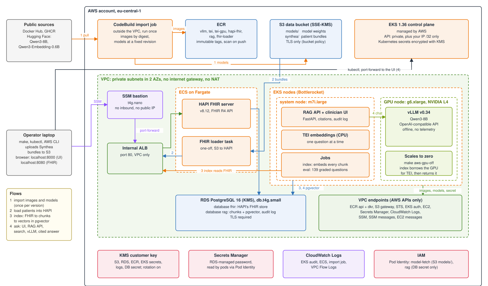

# private-clinical-ai

A private clinical AI assistant. It generates **synthetic** patients with
[Synthea](https://github.com/synthetichealth/synthea), stores them in a [HAPI FHIR](https://hapifhir.io/) R4
server, and answers clinicians' questions about one patient at a time with a self-hosted open model, citing
the exact FHIR records behind every statement. On AWS, every byte stays inside a VPC with no internet path.

- **Phase 1** (done): the data platform, locally and on AWS.
- **Phase 2**: retrieval-augmented answers with citations, an audit log, an evaluation suite and a clinician
  page. Developed and evaluated on a laptop with Ollama; the EKS deployment with vLLM is written and validated,
  and its first run on AWS is next.

> **No real patient data is used anywhere, and this is not clinical software.** All data is synthetic,
> generated by Synthea, and nothing here is meant for diagnosis or treatment. The platform still treats
> the data as PHI (encryption, network isolation, audit), because that is the point of the exercise.

## Architecture

```
laptop ──SSM port-forward──► bastion (no inbound, no public IP)
                                 │
 S3 (SSE-KMS) ──► loader task ──►│ internal ALB ──► HAPI FHIR (Fargate) ──► RDS PostgreSQL (KMS)
        ▲                        │
        │ VPC gateway endpoint   └── all AWS APIs via VPC endpoints; no IGW, no NAT
```

| Control | Implementation |
|---|---|
| No internet egress | No IGW/NAT; AWS APIs only via VPC endpoints; SG egress restricted to VPC + S3 prefix list |
| Encryption at rest | One customer-managed KMS key (rotation on) for S3, RDS, ECR, CloudWatch Logs, EBS, DB secret |
| Encryption in transit | TLS enforced on S3 (bucket policy) and PostgreSQL (`sslmode=require`) |
| Secrets | RDS-managed master password in Secrets Manager, injected into ECS; never in Terraform state |
| Least privilege | Separate task roles: HAPI has no data access beyond its DB; loader can only read the data bucket |
| Access | No SSH, no public endpoints; Session Manager only (logged in CloudTrail) |
| Network audit | VPC Flow Logs, KMS-encrypted |
| PHI-safe logging | Loader logs hashed IDs only (Synthea file names contain patient names) |
| Supply chain | Images mirrored to ECR with scan-on-push, immutable tags, pinned versions; Trivy misconfiguration scan in CI |

**Known gaps (on purpose, for the roadmap):** ALB is HTTP inside the VPC (next: ACM + HTTPS),
single-AZ RDS, no FHIR-level authorization yet (next: SMART on FHIR / Keycloak).

## Quick start: local

Runs on a laptop with Docker and Java 17 or newer, at no cost. Commands run from the repository root.

```bash
./synthea/generate.sh                             # 100 synthetic patients into synthea/output/fhir
docker compose -f local/docker-compose.yml up -d  # HAPI on http://localhost:8080/fhir, plus the phase 2 services
python3 loader/load_fhir.py --source synthea/output/fhir --fhir-url http://localhost:8080/fhir
curl -s 'http://localhost:8080/fhir/Patient?_summary=count'
```

Versions are pinned so the dataset and the server are the same on every run: Synthea v4.0.0 with seed 42,
HAPI FHIR v8.12.0-2, PostgreSQL 16.16. The same steps are `make generate`, `make up` and `make load`; the full
local workflow, including phase 2 and how to stop it, is under [Run it locally](#run-it-locally).

## Phase 1 on AWS: the data platform

One Terraform stack deploys both phases; the steps are under [Deploy phase 2 to AWS](#deploy-phase-2-to-aws). Phase 1's
part is HAPI FHIR on Fargate behind an internal load balancer, RDS PostgreSQL, the encrypted data bucket and an
SSM-only bastion, all in a VPC with no internet gateway and no NAT. Its share of the hourly cost:

| Resource | ~$/hour | ~$/month 24/7 |
|---|---|---|
| Fargate HAPI (1 vCPU, 4 GB) | 0.067 | 49 |
| RDS PostgreSQL db.t4g.small + 20 GB gp3 | 0.04 | 30 |
| Internal ALB | 0.03 | 20 |
| 7 interface endpoints, 1 AZ | 0.085 | 61 |
| Bastion t4g.nano, KMS, Secrets Manager, logs, S3 | ~0.01 | ~10 |
| **Total** | **~0.23** | **~170** |

Interface endpoints are the "privacy tax": the price of having no NAT. To browse the FHIR data on AWS, `make aws-ui`
opens HAPI at http://localhost:8080 through the bastion.

## Phase 2: answers with citations

```
HAPI FHIR ──▶ indexer ──▶ pgvector: chunks + embeddings, each tagged with its patient and FHIR references
                              │
clinician ──▶ RAG API ──▶ that patient's records only ──▶ qwen3:8b ──▶ answer, with [n] citations
                 └──▶ audit log: who asked about which patient, never the question or the answer
```

| Decision | Why |
| --- | --- |
| Retrieval is filtered by patient in SQL | Another patient's records can never reach the model, whatever the question says. Privacy is enforced in the database, not requested in a prompt. |
| Repeated observations are grouped per code, in date order | 840 FHIR resources become about 200 chunks, and a trend ("how has the HbA1c changed") is one retrieval instead of dozens. Billing resources are skipped. |
| Active conditions, active medications and allergies go with every question | "Which medications is the patient taking?" needs *all* of them. Similarity search returns only the closest few, and testing showed it missed every prescription for one patient. |
| The most similar records come first | With the current facts listed first, the 8B model missed a diagnosis that was in its context. Reordering fixed it. |
| Citations are checked | Each `[n]` is mapped back to its FHIR resources. A citation to a record the model was never given is reported, not dropped: it means an invented source. |
| One client for Ollama and vLLM | Both serve the OpenAI API, so the laptop and AWS differ only in a base URL, and in how Qwen3's thinking mode is switched off (`reasoning_effort` in Ollama, `chat_template_kwargs` in vLLM). |
| The audit log stores a hash of the question, not the text | Questions name diagnoses. An audit trail has to be safe to read. |
| `qwen3:8b` and `qwen3-embedding:0.6b` | Apache-2.0, and the same weights fit the AWS GPU (an NVIDIA L4, 24 GB), so local evaluations predict the deployed behaviour. |

**What testing found, and fixed.** A model answering from memory said an HbA1c of 6.79% suggests "prediabetes
or early-stage diabetes"; the standard threshold for diabetes is 6.5%, and the synthetic patient was diagnosed
the same day. That is why answers come only from the record. Building against real data then surfaced three
defects, each now covered by a test: Synthea's clinical status has no display text and was indexed as
"unknown"; a strict prompt refused to treat "onset" as "diagnosed"; and similarity search alone missed every
current prescription of one patient.

**Evaluation.** `make eval` asks five kinds of question per patient, with the expected answers computed from the
structured FHIR data, never from the model. Results on 30 patients, 139 questions:

| Question | First run | After fixes |
| --- | --- | --- |
| When was X diagnosed? (date, and cites that Condition) | 30/30 | 30/30 |
| Has the patient ever been prescribed Y? | 29/29 | 29/29 |
| Which medications is the patient currently taking? (all of them) | 11/20 | 17/20 |
| What was the most recent Z? | 30/30 | 30/30 |
| A condition the patient does not have (must say not recorded) | 30/30 | 30/30 |
| **Overall** | **130/139, 94%** | **136/139, 98%** |

The first run found two pipeline bugs: one shared limit on current facts let a long list of conditions push
medications out of the model's context, and the prompt did not say that the medication lists in visit notes
describe that visit, not today. It also found a grader bug: drugs were matched by the first word of their name,
which for "24 HR Metformin" is "24". All three are fixed and covered by tests. The three remaining failures are
the model leaving items out of long lists, with every item in its context. The "ever prescribed" question names
the drug, so it is the easiest; asking about drugs the patient never had is the next case to add.
[A recorded demo](docs/demo/local-2026-11-17.md) shows real answers with their sources.

**Known limitation.** The 8B model follows "say it is not recorded" reliably, but is unsteady on the cases
between "recorded" and "not recorded". For a patient with prediabetes and a kidney disorder due to diabetes,
but no plain diabetes diagnosis, one prompt version made it report the related record and then speculate that
another condition "may be related"; a stricter version makes it answer "not recorded" without mentioning the
related records. Neither is wrong about the data, but neither is what a clinician wants. The AWS phase compares a
larger model and MedGemma on the same evaluation suite.

### Run it locally

Needs Docker, Java 17+ and [Ollama](https://ollama.com). On an Apple Silicon Mac the model runs on the GPU;
the setup below was measured on an M3 Pro with 36 GB. Commands run from the repository root.

**First time** (about 30 minutes, mostly indexing):

```bash
brew services start ollama   # or start the Ollama app
make models       # qwen3:8b (5.2 GB) and qwen3-embedding:0.6b into Ollama
make generate     # 100 synthetic patients, about 20 seconds
make up           # HAPI, its database, pgvector and the RAG API
make load         # patients into HAPI, about a minute
make index        # patients into pgvector, about 20 minutes
```

**Afterwards**, `make up` is enough: patients and the index are kept in Docker volumes between runs.

### Try it

Open http://localhost:8000/ (`make ui`), pick a patient on the left, and ask a question or click
**Summarise history**. Patient IDs are assigned by HAPI when the data is loaded, so they differ between setups.

- Click a blue **[n]** in an answer to jump to its source, then the **FHIR records** link to open the record
  in HAPI and check the answer against the data.
- Ask about a condition the patient does not have. The answer should say it is not recorded.
- Ask "Which medications is the patient currently taking?" and compare with the patient's active prescriptions.
- The **Audit log** tab lists every request by user and patient, without the question or the answer.

From a terminal:

```bash
make patients                                                # patient IDs on this setup
make ask PATIENT=<id> Q="When was diabetes diagnosed?"       # one question, as JSON with sources
make summary PATIENT=<id>                                    # whole-history summary
make audit                                                   # the audit log
make eval                                                    # the evaluation suite, about 12 minutes
```

The API's interactive documentation is at http://localhost:8000/docs, and HAPI's own browser at
http://localhost:8080/.

**Your own data.** [docs/working-with-data.md](docs/working-with-data.md) lists which parts of a FHIR record the
assistant can answer about, shows how to add more Synthea patients or a patient written by hand
([an example bundle](docs/examples/handmade-patient.json)), and how to teach it a new kind of record.

### Stop and clean up

```bash
make down                                         # stop every container; patients and index are kept
brew services stop ollama                         # stop the model server (it frees memory after 5 idle minutes anyway)
docker compose -f local/docker-compose.yml down -v  # also delete the data: next time needs load and index again
docker ps                                         # nothing listed means nothing is running
```

## Deploy phase 2 to AWS

The same service on EKS, in the phase 1 VPC: no internet gateway, no NAT, every AWS API through a VPC endpoint.



Numbers on the arrows follow the flows: 1 import images and models, 2 load patients, 3 index, 4 ask. The editable source is [docs/architecture.drawio](docs/architecture.drawio) (open it in draw.io or app.diagrams.net, then export it over docs/architecture.svg).

**Deployed and evaluated on 19 November 2026** (us-west-2, one NVIDIA A10G): 105 patients indexed on the GPU in
under 7 minutes, answers in 1 to 3 seconds, **136/141 (96%)** on the evaluation suite, against 136/139 on the
laptop. The first real deploy also found nine problems that local runs and CI could not, from GPU capacity to a
Kubernetes environment variable that stopped vLLM; each is fixed in code. Transcript, raw logs and the list:
[docs/demo/aws-2026-11-19.md](docs/demo/aws-2026-11-19.md).

| Decision | Why |
| --- | --- |
| Images and models enter through an import job | The cluster cannot reach the internet. A CodeBuild job copies each image **by digest** and each model **at a fixed revision** into ECR and S3, so everything that runs was imported deliberately and scanned on push. |
| Bottlerocket, NVIDIA variant on the GPU node | A minimal, immutable OS that ships the NVIDIA 580 driver (vLLM v0.34's CUDA 13 build needs 580 or later) and the Kubernetes device plugin, so nothing GPU-related is installed into the cluster. |
| Embeddings on CPU for questions, on the GPU for indexing | One question embeds in well under a second on CPU. Bulk indexing does not: tested locally, CPU embedding would take hours for ~24,000 chunks. `make aws-index` lends the GPU to an embeddings server for the few minutes it takes, then gives it back to vLLM. |
| No database password in Kubernetes | The RAG pod reads the RDS-managed secret at startup through EKS Pod Identity. |
| vLLM offline, no usage statistics | `HF_HUB_OFFLINE`, `VLLM_NO_USAGE_STATS` and `DO_NOT_TRACK` are set: vLLM reports usage by default. |
| GPU node scales to zero | `make aws-gpu-off` stops the largest cost without destroying anything. The GPU quota (4 vCPUs) allows exactly one g6.xlarge. |
| g5.xlarge as a fallback | GPU capacity runs out: on the first deploy, g6.xlarge was unavailable in all three eu-central-1 zones. The node group also spans every zone and falls back to g5.xlarge (NVIDIA A10G, same 24 GB, same quota) only when g6 cannot be launched. |
| Kubernetes API public, but only from your IP | So `kubectl` works from a laptop. Data and model traffic never leave the VPC. A fully private API through the SSM bastion is the stricter alternative. |

Accepted security findings, each with its reason, are in [.trivyignore.yaml](.trivyignore.yaml): the API endpoint above,
and vLLM running as root until non-root operation is verified on a GPU. Everything else, TEI and every init container
included, runs non-root with a read-only root filesystem.

### Before the first deploy

- An AWS account with **4 vCPUs of "Running On-Demand G and VT instances"** quota in eu-central-1 (the default is 0;
  request it in Service Quotas a few days ahead).
- An **AWS Budgets alert**. Left running, the stack costs about 38 USD a day.
- AWS CLI with the Session Manager plugin, Terraform >= 1.10, kubectl and Docker.
- **GPU capacity is not guaranteed.** On the first deploy (a weekday afternoon), eu-central-1 had no g6.xlarge in any
  of its three zones and no g5.xlarge either; EC2 reports `InsufficientInstanceCapacity` in the GPU node group's
  Auto Scaling activity while the node group stays in `CREATING`. Try off-peak, keep `GPU=0` until everything else
  is ready, and set it back to 0 (or destroy) if no node appears, so a GPU does not start later unattended. To hold
  a GPU once one is available, create an On-Demand Capacity Reservation for it. Creating the reservation is also
  the quickest capacity check: it fails at once, for free, when the zone has no GPU. With GPU quota in a second
  region, every AWS target takes `REGION=` (for example `make aws-apply REGION=eu-west-1 HAPI=0 GPU=0`); the
  default stays eu-central-1, and the Makefile refuses a region other than the one the stack is deployed in.

### Deploy, test, destroy

```bash
cp terraform/backend.hcl.example terraform/backend.hcl   # your state bucket
make aws-init
make aws-apply HAPI=0 GPU=0     # VPC, EKS, RDS, buckets, import job; no HAPI and no GPU yet (~20 min)
make aws-import                 # images to ECR, models to S3 (~20 min the first time)
make aws-push                   # loader and RAG images
make aws-apply                  # starts HAPI and the GPU node
make aws-kubeconfig
make aws-deploy                 # vLLM, TEI, RAG API; waits until ready (~10 min, mostly loading the model)
make aws-data                   # synthetic patients into HAPI
make aws-index                  # embeddings on the GPU, then vLLM restarts
make aws-eval                   # the evaluation suite against the deployed API
make aws-ui                     # http://localhost:8000 and http://localhost:8080, through private tunnels
make aws-destroy                # everything; then check with make aws-leftovers
```

`make aws-gpu-off` stops just the GPU between sessions.

### Cost (eu-central-1, approximate)

| | Per hour |
| --- | --- |
| GPU node, g6.xlarge on demand | 1.01 USD |
| (g5.xlarge instead, only when g6 has no capacity) | (~1.26 USD) |
| Phase 1 stack (HAPI, RDS, load balancer, endpoints) | 0.23 USD |
| EKS control plane | 0.10 USD |
| System node, m7i.large | ~0.12 USD |
| Three more VPC endpoints, disks, logs | ~0.06 USD |
| **Everything running** | **~1.50 USD** |

A test session costs about 3 to 4 USD: deploying and destroying take most of an hour themselves. The import job is
a few cents per run.

## Tests and CI

```bash
pip install -r requirements-dev.txt
ruff check . && pytest
```

The RAG tests cover chunking, citation checking, patient scoping and the API (user required, inputs
validated, every answer audited), with fakes in place of the database and the model, so they run in CI
without a GPU. The evaluation suite (`make eval`) runs the real model and is the check for answer quality.

The loader tests run it against a fake FHIR server that fails on purpose: reference bundles must load before
any patient, 503, 429 and 500 responses are retried, 4xx responses are not, and no log line ever contains a
patient name. CI also runs `terraform fmt` and `validate`, tflint, a Trivy misconfiguration scan and shellcheck.

## Roadmap

- **Phase 2 on AWS:** first deployment and evaluation on the GPU, with the results next to the laptop's
- Run vLLM non-root with a read-only root filesystem, once verified on a GPU, and remove its exception
- Keycloak in place of the trusted `X-User` header, so each clinician sees only their own patients
- Bedrock via PrivateLink as a switchable backend + ADR comparing cost, compliance and quality
- Compare qwen3:8b with a larger model and MedGemma on the evaluation suite, recorded as a decision record
- ArgoCD GitOps, Kyverno policies, Infracost in PRs

## License

[Apache-2.0](LICENSE)
