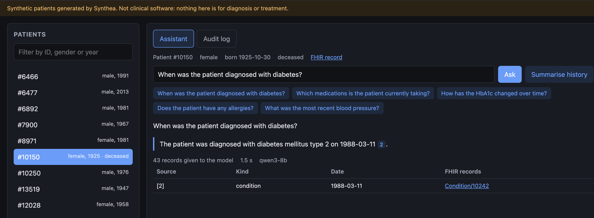

# AWS demo, 19 November 2026

The full phase 2 stack deployed with Terraform to a private VPC in us-west-2, used through the clinician page,
evaluated, and destroyed the same day. The raw logs are in [aws-2026-11-19/](aws-2026-11-19/).

All data is synthetic (Synthea). This is not clinical software.

## What ran

| Part | Where |
| --- | --- |
| Chat model | Qwen3-8B (bf16) in vLLM v0.34.0, on one **g5.xlarge (NVIDIA A10G, 24 GB)**, Bottlerocket NVIDIA, EKS 1.36 |
| Embeddings | Qwen3-Embedding-0.6B in TEI: on the CPU node for questions, on the GPU for bulk indexing |
| RAG API and clinician page | FastAPI on the system node (m7i.large), Pod Identity for the database secret |
| FHIR server | HAPI FHIR on Fargate behind an internal load balancer, RDS PostgreSQL with pgvector |
| Network | No internet gateway, no NAT; AWS APIs through VPC endpoints; images and models brought in by the import job |
| Access | kubectl port-forward for the page, Session Manager through the bastion for HAPI; nothing listens publicly |

[cluster.txt](aws-2026-11-19/cluster.txt) shows the two nodes and the pods. [vllm.log](aws-2026-11-19/vllm.log) shows
the model server starting on the GPU and its throughput while the evaluation ran.

## Results

| | AWS (A10G) | Mac (M3 Pro, Ollama), 17 November |
| --- | --- | --- |
| Patients indexed | 117 records (105 patients, 12 loaded twice, see below) | 105 |
| Chunks embedded | 33,636 | 23,859 |
| Indexing time | **6 min 39 s** on the GPU | 19 min |
| Typical answer time | **1 to 3 s** (current medications up to 10 s) | 3 to 16 s |
| Evaluation | **136/141, 96%** | 136/139, 98% |

Evaluation by question kind ([eval.log](aws-2026-11-19/eval.log), same suite as locally):

| Question | AWS | Local |
| --- | --- | --- |
| When was X diagnosed? | 29/30 | 30/30 |
| Has the patient ever been prescribed Y? | 30/30 | 29/29 |
| Which medications is the patient currently taking? (all of them) | 17/21 | 17/20 |
| What was the most recent Z? | 30/30 | 30/30 |
| A condition the patient does not have (must say not recorded) | 30/30 | 30/30 |

The suite takes the first 30 patients by FHIR server ID, and the IDs depend on load order, so the two runs grade
similar but not identical patient sets. The pattern matches the local run: the misses are long current-medication
lists with items left out, and no answer claimed a condition the patient does not have.

vLLM on the A10G: weights loaded in 2 minutes from the node's disk, CUDA graphs captured in 11 seconds, 18,944
tokens of KV cache (the 16k context fits). While evaluating it processed prompts at up to about 890 tokens/s and
generated about 18 to 25 tokens/s for one request at a time.

## An answer with its source

Patient 10150, "When was the patient diagnosed with diabetes?", 43 records given to the model, 1.5 s:

```text
The patient was diagnosed with diabetes mellitus type 2 on 1988-03-11 [2].
```

| Cited | Kind | Date | FHIR records |
| --- | --- | --- | --- |
| [2] | condition | 1988-03-11 | Condition/10242 |

The citation opens `Condition/10242` in HAPI, through the Session Manager tunnel, and its onset date matches.



## What the first real deploy found

Everything below passed locally and in CI. Each was found on AWS, fixed in code, and is now part of the repository.

| Problem | Cause | Fix |
| --- | --- | --- |
| No GPU node for hours | No g6.xlarge capacity in any eu-central-1 zone, then no g5.xlarge either | GPU node group across every zone, g5.xlarge as a fallback type, a second region, and an On-Demand Capacity Reservation created first: it fails at once, for free, when there is no GPU |
| Node group rejected | A targeted reservation only serves its own zone | With a reservation, the GPU node group uses only that zone's subnet |
| Scripts in the wrong region | The AWS CLI default region was used | Every script reads the region from Terraform |
| vLLM exited on start | Kubernetes injects `VLLM_PORT=tcp://...` for a Service named `vllm`; vLLM reads it as its own setting | `enableServiceLinks: false` on every pod |
| TEI killed while warming up | Memory on a real x86 CPU is higher than under emulation | Smaller warm-up batch, 6 GiB limit |
| TEI update stuck | A rolling update needs room for two copies on a 2-vCPU node | Recreate strategy |
| GPU embeddings server refused to start | The pinned TEI image was built for Ada (L4) only; the fallback GPU is Ampere (A10G) | The universal CUDA image, which runs on both |
| Index job failed at once | It started before the embeddings server was ready | Server first, then the job; Ctrl+C no longer pulls the server from under a running job |
| 12 patients loaded twice | Large transactions outlasted the load balancer's 60 s timeout (504), and the loader's retry posted the bundle again; Synthea creates everything with plain POST | Timeout raised to 300 s; the loader checks whether the patient exists before every attempt, which also makes reloads resume. The duplicates are complete copies and give the same answers |

Still open: the page shows a bare HTTP 500 while vLLM restarts (it should say the model is starting), and the
Session Manager tunnel to HAPI closes after 20 idle minutes (the script should reopen it).

## Cost

About five hours of the stack, most of it with the GPU held by the reservation: roughly 7 USD, including the
import job. Everything was destroyed afterwards and the reservation cancelled.
